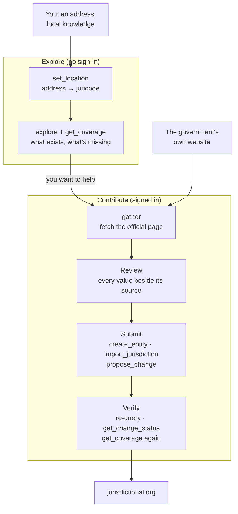

# jurisdictional-skill

A [Claude Code plugin](https://code.claude.com/docs/en/plugins) that connects you to the governments that serve your address, and helps you add what's missing to [jurisdictional.org](https://jurisdictional.org).

Tell it where you live.
It shows you every layer of government — federal to local — the agencies, the councils and the people on them, the services you can use, and what nobody has recorded yet.
Then, if you want, it helps you fill the gaps from the government's own website, with a source link on every fact.

## Install

In Claude Code:

```
/plugin marketplace add jurisdictional/jurisdictional-skill
/plugin install jurisdictional@jurisdictional
```

Start a new session, then:

```
/gather 300 Hemlock St, Vacaville, CA
```

Already contributing? `/gather next CA` skips the address and picks the most useful place in California to work on next.

The plugin connects Claude to the Jurisdictional MCP server at `https://jurisdictional.org/mcp`.
To use the server without the skill: `claude mcp add --transport http jurisdictional https://jurisdictional.org/mcp`.

### Other assistants

The same server works from Grok: as a custom connector on grok.com, with `grok mcp add --transport http jurisdictional https://jurisdictional.org/mcp` in Grok Build, or as a remote MCP tool in the xAI API.
xAI's docs say Grok Build also reads Claude Code marketplaces, plugins and skills.
Per-assistant steps, with sign-in, are at [jurisdictional.org/skill](https://jurisdictional.org/skill).

Privacy: [jurisdictional.org/privacy](https://jurisdictional.org/privacy).
Support: [jurisdictional.org/support](https://jurisdictional.org/support).

## Usage

The skill starts by showing you what's there, not by asking what to contribute.
Exploring is a complete experience — you don't have to add anything.

If you do want to help, it reads the official website, shows you each proposed fact next to its source, and submits only what you approve.

## How it works



## Signing in

**Exploring works without an account.**
Researching pages and contributing need you to sign in, which happens in your browser:

1. In a terminal window of its own, run:

   ```
   claude mcp login plugin:jurisdictional:jurisdictional
   ```

   (If you added the server by hand with `claude mcp add`, the name is `jurisdictional`.)
2. Approve on jurisdictional.org (sign in with GitHub if asked).
3. Start a new Claude Code session.
   Its `/mcp` tool list for `jurisdictional` now includes `propose_change`.

Claude Code stores and refreshes the sign-in for you.

### Other MCP clients

A client without browser sign-in can send a token instead.
Copy one from [jurisdictional.org/auth/cli](https://jurisdictional.org/auth/cli) and configure your client to send it as an `Authorization: Bearer jur_...` header to `https://jurisdictional.org/mcp`.
A configured header takes precedence over the browser sign-in, so remove it if you switch.
Earlier versions of this plugin read `~/.jurisdictional/token`; this version doesn't, and you can delete that file.

## What you can contribute

| Contribution | How it lands |
|------|-------------|
| Departments a city is missing, or a whole city's agencies, bodies and services at once | New entities, live right away |
| Services — what residents can pay, apply for, report or reserve, with the link to do it | New entities, live right away |
| Councils, boards and their seats, and who holds each seat | New entities and tenures, live right away |
| Meetings, with agenda, minutes and video links | New entities, live right away |
| Phone, email, website and other fixes to existing records | Proposed changes, reviewed by a person |
| A second source confirming a value already there | Corroboration, recorded right away |
| Official headshots, city logos and flags | Image candidates, reviewed before they're shown |

Every value needs a source: a page fetched from the government's site, or your own local knowledge, attributed as yours.
Search snippets and the model's memory are never sources.

## Data format

Contributions go to jurisdictional.org through the MCP tools.
If you also want local files, the skill can write one JSON file per entity, in the format of the [jurisdictional/data](https://github.com/jurisdictional/data) repo:

```json
{
  "_meta": {
    "source": "https://www.cityofvacaville.gov/government/police-department",
    "retrieved_at": "2026-10-23",
    "contributor": "your-github-username"
  },
  "name": "Vacaville Police Department",
  "agency_type": "police",
  "jurisdiction": "vacaville-ca",
  "url": "https://www.cityofvacaville.gov/government/police-department",
  "phone": "707-449-5200"
}
```

See [schema.md](skills/gather/schema.md) for field definitions and [examples/austin-tx/](skills/gather/examples/austin-tx/) for a complete sample.

## Contributing

The best way to contribute is to run `/gather` for your city.

Changes to the skill itself are welcome.
The flow is in [SKILL.md](skills/gather/SKILL.md), and what each MCP tool does is in [references/tools.md](skills/gather/references/tools.md).
Before opening a pull request, run `claude plugin validate .` and the scenarios in [TESTING.md](TESTING.md).

## License

MIT — see [LICENSE](LICENSE).
