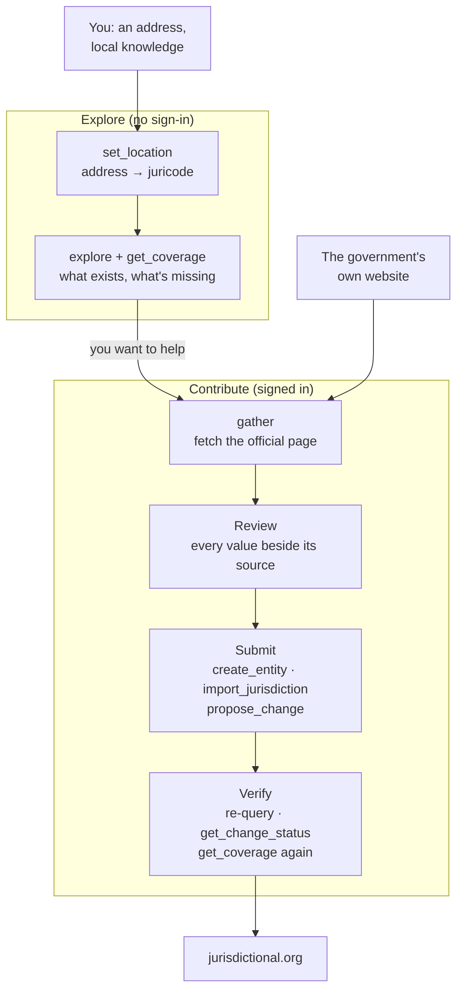

# jurisdictional-skill

A [Claude Code plugin](https://code.claude.com/docs/en/plugins) that connects you to the governments that serve your address, and helps you add what's missing to [jurisdictional.org](https://jurisdictional.org).

Tell it where you live.
It shows you every layer of government — federal to local — the agencies, the councils and the people on them, the services you can use, and what nobody has recorded yet.
Then, if you want, it helps you fill the gaps from the government's own website, with a source link on every fact.

## Install

In Claude Code:

```
/plugin marketplace add jurisdictional/jurisdictional-skill
/plugin install jurisdictional@jurisdictional
```

Start a new session, then:

```
/gather 300 Hemlock St, Vacaville, CA
```

The plugin connects Claude to the Jurisdictional MCP server at `https://jurisdictional.org/api/mcp/message`.
To use the server without the skill: `claude mcp add --transport http jurisdictional https://jurisdictional.org/api/mcp/message`.

## Usage

The skill starts by showing you what's there, not by asking what to contribute.
Exploring is a complete experience — you don't have to add anything.

If you do want to help, it reads the official website, shows you each proposed fact next to its source, and submits only what you approve.

## How it works



## Signing in

**Exploring works without an account.**
Researching pages and contributing need a jurisdictional.org token:

1. Paste this command at the Claude Code prompt, but **don't press Enter yet** (copying it replaces your clipboard, so it comes first).
   It saves the token from your clipboard to `~/.jurisdictional/token`, without the token entering the chat, and only if the clipboard holds a `jur_...` key:

   ```
   ! mkdir -p ~/.jurisdictional && t=$(pbpaste | tr -d '[:space:]'); case "$t" in jur_*[!A-Za-z0-9_-]*) t= ;; jur_*) (umask 077; printf '%s\n' "$t" > ~/.jurisdictional/token) && chmod 600 ~/.jurisdictional/token && echo "Token saved." ;; *) t= ;; esac; [ -n "$t" ] || echo "Not saved: the clipboard holds no jurisdictional.org token (jur_...). Copy it from jurisdictional.org/auth/cli, then run this again."
   ```

   (On Linux, use `xclip -o -selection clipboard` in place of `pbpaste`.)
2. Open [jurisdictional.org/auth/cli](https://jurisdictional.org/auth/cli), sign in with GitHub, copy the token, and press Enter on the command.
3. On "Token saved.", run `/mcp` and reconnect `jurisdictional`, or start a new session.

The plugin sends the token only when that file holds a `jur_...` key; otherwise you get the public read-only tools.
If you added the server by hand with an `Authorization` header, update that header instead.

## What you can contribute

| Contribution | How it lands |
|------|-------------|
| Departments a city is missing, or a whole city's agencies, bodies and services at once | New entities, live right away |
| Services — what residents can pay, apply for, report or reserve, with the link to do it | New entities, live right away |
| Councils, boards and their seats, and who holds each seat | New entities and tenures, live right away |
| Meetings, with agenda, minutes and video links | New entities, live right away |
| Phone, email, website and other fixes to existing records | Proposed changes, reviewed by a person |
| A second source confirming a value already there | Corroboration, recorded right away |
| Official headshots, city logos and flags | Image candidates, reviewed before they're shown |

Every value needs a source: a page fetched from the government's site, or your own local knowledge, attributed as yours.
Search snippets and the model's memory are never sources.

## Data format

Contributions go to jurisdictional.org through the MCP tools.
If you also want local files, the skill can write one JSON file per entity, in the format of the [jurisdictional/data](https://github.com/jurisdictional/data) repo:

```json
{
  "_meta": {
    "source": "https://www.cityofvacaville.gov/government/police-department",
    "retrieved_at": "2026-10-23",
    "contributor": "your-github-username"
  },
  "name": "Vacaville Police Department",
  "agency_type": "police",
  "jurisdiction": "vacaville-ca",
  "url": "https://www.cityofvacaville.gov/government/police-department",
  "phone": "707-449-5200"
}
```

See [schema.md](skills/gather/schema.md) for field definitions and [examples/austin-tx/](skills/gather/examples/austin-tx/) for a complete sample.

## Contributing

The best way to contribute is to run `/gather` for your city.

Changes to the skill itself are welcome.
The flow is in [SKILL.md](skills/gather/SKILL.md), and what each MCP tool does is in [references/tools.md](skills/gather/references/tools.md).
Before opening a pull request, run `claude plugin validate .` and the scenarios in [TESTING.md](TESTING.md).

## License

MIT — see [LICENSE](LICENSE).
